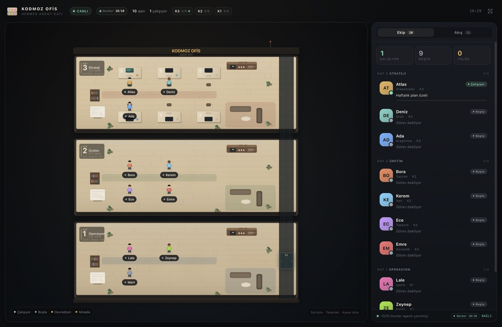

# Kodmoz Ofis

Hermes agentlarını **katlı bir ofis** olarak gösteren, tarayıcı tabanlı yönetim ve görselleştirme uygulaması.

10 agent, tek bir Docker konteynerinde **10 izole Hermes profili** olarak çalışır. Her agentın kendi masası, katı, model oturumu, hafızası ve API sunucusu vardır. Ofis ekranından:

- kimin çalıştığını ve ne üzerinde çalıştığını canlı görürsün,
- gerçek görev gönderirsin,
- bir agent diğerine iş devrettiğinde kalkıp hedefin masasına yürümesini izlersin,
- agentların **ismini ve görev tanımını** arayüzden değiştirirsin,
- Docker profillerini tek tek başlatır, durdurur veya yeniden başlatırsın.



---

## Hızlı başlangıç

### 1. Gereksinimler

- Node.js 20+
- Docker Desktop (macOS / Apple Silicon üzerinde test edildi)
- Bir OpenAI uyumlu model sağlayıcısı (varsayılan: CommandCode, `deepseek/deepseek-v4.1-flash`)

### 2. Depoyu al ve bağımlılıkları kur

```bash
git clone https://github.com/hasanislamoglu5361/kodmoz-office.git
cd kodmoz-office
npm install
```

### 3. Gizli değerleri ve Docker modunu ayarla

```bash
cp .env.example .env
# .env içinde HERMES_DOCKER=1 yap (Docker modu)

cp secrets.env.example runtime/secrets.env
```

`runtime/secrets.env` içini doldur:

```bash
HERMES_LLM_BASE_URL=https://api.commandcode.ai/provider/v1
HERMES_LLM_MODEL=deepseek/deepseek-v4.1-flash
HERMES_LLM_API_KEY=...
HERMES_AGENTS_API_KEY=$(openssl rand -hex 32)
OFFICE_URL=http://host.docker.internal:4173
```

- `HERMES_LLM_API_KEY`: agentların kullanacağı model sağlayıcı anahtarı.
- `HERMES_AGENTS_API_KEY`: ofisin her Hermes profilinin API sunucusuna erişirken kullanacağı anahtar. En az 8 karakter olmalı.
- `OFFICE_URL`: konteynerin ofis sunucusuna erişeceği adres. Docker Desktop'ta `host.docker.internal`, Linux'ta host IP'si.

`runtime/` ve `.env` git'e **girmez**. Anahtarları asla commit etme.

### 4. Docker ofisini kur

```bash
npm run docker:setup
```

Bu komut:

1. resmi `nousresearch/hermes-agent` imajını çeker (yoksa),
2. `kodmoz-hermes` konteynerini başlatır,
3. 10 Hermes profilini oluşturur (`atlas`, `deniz`, `ada`, `bora`, `kerem`, `ece`, `emre`, `lale`, `zeynep`, `mert`),
4. her profile model, kimlik, SOUL ve ofis köprüsünü yazar,
5. gateway'leri başlatır ve 8642–8651 aralığındaki API sunucularını sağlık kontrolünden geçirir.

Kurulumu tekrar çalıştırmak güvenlidir; mevcut profilleri ve arayüzden yaptığın isim/rol düzenlemelerini korur. `SOUL.md` dosyalarını seed'den sıfırlamak istersen:

```bash
npm run docker:setup -- --reset-soul
```

### 5. Ofisi aç

```bash
npm start
```

- Yerel: [http://localhost:4173](http://localhost:4173)
- Ağ: açılışta yazdırılan `http://<lan-ip>:4173`
- Geliştirme: `npm run dev` (Vite 5173 + API 4173)

### Demo modu

Docker kurmadan arayüzü görmek istersen `HERMES_DOCKER` ayarlamadan çalıştır:

```bash
npm run dev
```

Aynı 10 agent demo simülasyonuyla görünür; görevler, devirler ve yürüme animasyonları çalışır. Docker modunda demo simülasyonu otomatik kapanır.

---

## Ofisteki 10 agent

| Agent | Rol | Kat | Docker profili | API portu |
| --- | --- | --- | --- | --- |
| Atlas | Orkestratör | K3 Strateji | `default` | 8642 |
| Deniz | Ürün | K3 Strateji | `deniz` | 8643 |
| Ada | Araştırma | K3 Strateji | `ada` | 8644 |
| Bora | Yazılım | K2 Üretim | `bora` | 8645 |
| Kerem | Veri | K2 Üretim | `kerem` | 8646 |
| Ece | Tasarım | K2 Üretim | `ece` | 8647 |
| Emre | Güvenlik | K2 Üretim | `emre` | 8648 |
| Lale | İçerik | K1 Operasyon | `lale` | 8649 |
| Zeynep | Kalite | K1 Operasyon | `zeynep` | 8650 |
| Mert | DevOps | K1 Operasyon | `mert` | 8651 |

Başlangıç tanımları `data/office.json` içindedir. İsim ve görev tanımlarını arayüzden değiştirdiğinde:

1. ofis `data/agent-overrides.json` dosyasına yazar (yerel, git dışı),
2. Docker profilinin `SOUL.md` ve `.env` dosyasını günceller,
3. ilgili profilin gateway'ini yeniden başlatır,
4. yeni oturumdan itibaren agent yeni kimliğiyle çalışır.

---

## Kullanım

- **Gezinme:** Canvas'ı sürükle, tekerlekle yakınlaştır, ajana tıkla. `Tüm binayı sığdır` ile geri dön.
- **Katlar:** Üst bardaki `K3 / K2 / K1` çipleri veya mobil kat şeridi.
- **Görev ver:** Agent detayında `Görev ver`. Görev gerçek Hermes profiline `/v1/runs` ile gönderilir; agent çalışırken monitörü ve canlı halkası yanar.
- **İş devret:** Kaynak agent hedefin masasına yürür (kat farkı varsa asansörle). Teslimden sonra görev hedefin Docker profiline gönderilir; kaynak masasına döner.
- **Profili düzenle:** Agent detayında `İsim / rol tanımını düzenle`. İsim, rol ve görev tanımı arayüzden değişir.
- **Docker kontrolü:** Agent detayında `Başlat`, `Durdur`, `Yeniden başlat`. Panel altbilgisindeki `Docker 10/10` düğmesi tüm konteyneri durdurur/başlatır.
- **Akış:** Görev, devir, teslim, oturum ve sistem olayları; türe göre filtreli.

Agent bir alt görev açtığında (Hermes `delegate_task`), ofiste geçici bir alt agent belirir ve devir animasyonu oynar. Bu agentlar iş bitince çevrimdışı kalır.

### Durumlar

| Durum | Anlamı |
| --- | --- |
| Çalışıyor | Gerçek bir Hermes çalıştırması sürüyor |
| Boşta | Gateway çalışıyor, görev bekliyor |
| Yolda | Ofiste hareket ediyor / asansörde |
| Devrediyor | Bir işi başka bir agenta götürüyor |
| Molada | Kahve köşesinde (demo modu) |
| Onay bekliyor | Bloke veya görev gönderilemedi |
| Çevrimdışı | Docker profili durmuş ya da erişilemiyor |

---

## Mimari

```
Tarayıcı (React + Canvas)
        │ HTTP / WebSocket
        ▼
Ofis sunucusu (Express + ws, :4173)
        │ docker exec / health /v1/runs
        ▼
kodmoz-hermes konteyneri
  ├─ default (Atlas)   :8642  gateway + API server
  ├─ deniz             :8643
  ├─ ada               :8644
  ├─ ...
  └─ mert              :8651
        │ her profil kendi SOUL / memory / session / .env
        │ hermes-office plugin → POST /api/hermes/event
        ▼
Ofis sunucusu (canlı durum, görev, devir)
```

- **Ofis sunucusu** tek doğruluk kaynağıdır: agent durumları, hareket, asansör, görevler ve Docker sağlığı.
- **Docker profilleri** birbirinden izoledir: ayrı `config.yaml`, `.env`, `SOUL.md`, hafıza, oturum ve gateway süreci.
- **Köprü plugin'i** her profilin observer hook'larından oturum, LLM turu, araç çağrısı ve alt ajan olaylarını ofise yollar.
- **Görev gönderimi** `POST /v1/runs` ile yapılır; ofis `run_id` ile durumu yoklar, köprü olayları anlık olarak arayüze yansıtır.
- **Profil düzenleme** doğrudan host'taki `runtime/hermes-data/profiles/<profil>/SOUL.md` ve `.env` dosyalarına yazılır, ardından gateway yeniden başlatılır.
- **Güvenlik:** Hermes API portları yalnızca `127.0.0.1`'e publish edilir. Ofis arayüzü isteğe bağlı `OFFICE_TOKEN` ile korunur.

### Docker düzeni

- Tek konteyner, 10 ayrı Hermes profili (8 GB Docker RAM için verimli).
- API portları: `8642–8651`, sadece localhost.
- Profiller `gateway.standalone` shim'i ile bağımsız gateway süreçleri olarak çalışır; böylece her agent tek tek başlatılıp durdurulabilir.
- Konteyner adı: `kodmoz-hermes`; veri dizini: `runtime/hermes-data`.
- İmaj: `nousresearch/hermes-agent:latest` (~4.6 GB).

---

## Hermes köprüsü

Köprü `hermes-plugin/hermes-office/` altındadır ve Docker kurulumunda her profile otomatik kopyalanır + etkinleştirilir.

Her profilin `.env` dosyasında şu kimlik alanları bulunur:

```bash
OFFICE_URL=http://host.docker.internal:4173
API_SERVER_ENABLED=true
API_SERVER_HOST=0.0.0.0
API_SERVER_PORT=8643
API_SERVER_KEY=...
HERMES_OFFICE_AGENT_ID=deniz
HERMES_OFFICE_AGENT_NAME=Deniz
HERMES_OFFICE_ROLE=Ürün
HERMES_OFFICE_SEND_TITLES=1
```

Köprü şu hook'ları kullanır: `on_session_start`, `on_session_end`, `on_session_finalize`, `pre_llm_call`, `post_llm_call`, `pre_tool_call`, `post_tool_call`, `subagent_start`, `subagent_stop`.

- Gönderim arka plan thread'inde, 1.5 sn timeout ile ve **fail-open** yapılır; ofis kapalıysa Hermes etkilenmez.
- Araç argümanları, dosya içerikleri ve komut çıktıları gönderilmez. Yalnızca oturum kimliği, agent kimliği, model/platform, araç adı ve 90 karaktere kısaltılmış görev başlığı gönderilir.
- `HERMES_OFFICE_SEND_TITLES=0` ile görev başlıkları da kapatılabilir.

### Manuel olarak tek profile kurmak

```bash
docker cp hermes-plugin/hermes-office kodmoz-hermes:/opt/data/plugins/
docker exec kodmoz-hermes hermes plugins enable hermes-office
docker exec kodmoz-hermes hermes gateway restart
```

Profil için:

```bash
docker cp hermes-plugin/hermes-office kodmoz-hermes:/opt/data/profiles/<profil>/plugins/
docker exec kodmoz-hermes hermes -p <profil> plugins enable hermes-office
docker exec kodmoz-hermes hermes -p <profil> gateway restart
```

---

## API

Token açıksa `Authorization: Bearer <OFFICE_TOKEN>` veya `?token=` gerekir.

| Metot | Yol | Açıklama |
| --- | --- | --- |
| `GET` | `/api/state` | Tam anlık görüntü (agentlar, Docker durumu, olaylar) |
| `GET` | `/api/health` | Sağlık, uptime, Docker ve bağlantı bilgisi |
| `GET` | `/api/docker/status` | Konteyner ve profil sağlığı |
| `GET` | `/api/events?since=<ms>` | Zaman damgasından sonraki olaylar |
| `POST` | `/api/agents/:id/task` | `{ "title": "...", "detail": "..." }` — gerçek görev |
| `POST` | `/api/agents/:id/profile` | `{ "name", "role", "about" }` — profili düzenle |
| `POST` | `/api/agents/:id/power` | `{ "action": "start" \| "stop" \| "restart" }` |
| `POST` | `/api/docker/container` | `{ "action": "start" \| "stop" \| "restart" }` |
| `POST` | `/api/delegations` | `{ "from": "atlas", "to": "bora", "title": "..." }` |
| `POST` | `/api/hermes/event` | Köprü olayı |
| `POST` | `/api/simulator` | Demo simülasyon kontrolü |
| `WS` | `/ws` | Bağlantıda `snapshot`, sonra `tick` / `event` / `simulator` |

Örnek:

```bash
# Gerçek görev
curl -X POST http://localhost:4173/api/agents/ada/task \
  -H 'content-type: application/json' \
  -d '{"title":"Rakip analizi","detail":"Üç rakip için kısa karşılaştırma çıkar."}'

# İş devri
curl -X POST http://localhost:4173/api/delegations \
  -H 'content-type: application/json' \
  -d '{"from":"atlas","to":"bora","title":"Ödeme akışını gözden geçir"}'

# Profili yeniden başlat
curl -X POST http://localhost:4173/api/agents/ada/power \
  -H 'content-type: application/json' \
  -d '{"action":"restart"}'
```

---

## Dosya yapısı

```
kodmoz-office/
  data/office.json              # 10 agent, kat, masa, profil, port
  shared/types.ts               # sunucu + istemci tipleri
  server/
    index.ts                    # Express API + WebSocket + statik yayın
    store.ts                    # agent/görev durumu, yürüme, asansör, olaylar
    layout.ts                   # kat/masa geometrisi
    simulation.ts               # demo davranışı
    docker.ts                   # Docker profilleri, health, görev gönderimi
    hermes.ts                   # Hermes observer olaylarını eşleme
    config.ts                   # .env + runtime/secrets.env yükleme
  src/
    scene/                      # Canvas ofis renderer, kamera, etkileşim
    components/                 # üst bar, ekip/akış, detay, dialoglar
  hermes-plugin/hermes-office/  # Hermes observer köprüsü
  scripts/docker-setup.mjs      # 10 profilli Docker kurulumu
  runtime/                      # gizli veriler + Hermes profilleri (git dışı)
```

---

## Erişim ve güvenlik

Ofis sunucusu varsayılan olarak `0.0.0.0:4173` dinler. Dışarıya açmadan önce:

```bash
OFFICE_TOKEN=uzun-rastgele-bir-deger npm start
```

Arayüz ilk açılışta token sorar; token yalnızca tarayıcıda saklanır.

Uzak erişim için:

```bash
# Tailscale
tailscale up
tailscale ip -4
# http://100.x.y.z:4173

# veya Cloudflare Tunnel
cloudflared tunnel --url http://localhost:4173
```

**Hermes API portlarını (8642–8651) internete açma.** Bu portlar zaten yalnızca localhost'a bağlıdır; ofis sunucusu onlara host üzerinden erişir.

Model sağlayıcısı (CommandCode vb.) görev metinlerini ve agent bağlamını dışarıya gönderir; hassas verileri görev olarak vermeden önce bunu göz önünde bulundur.

---

## Sorun giderme

- **10/10 yerine 9/10 veya daha az:** `docker ps`, `docker logs kodmoz-hermes`, `npm run docker:setup` ile sağlık durumunu kontrol et. Tek profil için arayüzden `Yeniden başlat`.
- **Görev gönderilemiyor / `Agent API 401`:** `runtime/secrets.env` içindeki `HERMES_AGENTS_API_KEY` ile profillerin `.env` dosyasındaki `API_SERVER_KEY` aynı olmalı. `npm run docker:setup` bunu senkronlar.
- **Model hatası:** `HERMES_LLM_BASE_URL`, `HERMES_LLM_MODEL` ve `HERMES_LLM_API_KEY` değerlerini kontrol et. Model kimliği sağlayıcının `/v1/models` çıktısındaki tam kimlik olmalı (ör. `deepseek/deepseek-v4.1-flash`).
- **Köprü olayları gelmiyor:** Profilin `.env` dosyasında `OFFICE_URL` doğru mu? Konteynerden `curl http://host.docker.internal:4173/api/health` çalışıyor mu? `hermes -p <profil> plugins list` ile `hermes-office` etkin mi?
- **Konteyner yeniden başladı:** Profiller `gateway_state.json` durumuna göre geri gelir. 10 profilin tamamı 2–3 dakika içinde ayağa kalkabilir; gelmeyen profili arayüzden başlat.
- **Port çakışması:** `8642–8651` aralığını başka bir süreç kullanıyorsa `data/office.json` portlarını ve `scripts/docker-setup.mjs` publish aralığını birlikte değiştir.

---

## Komutlar

| Komut | Açıklama |
| --- | --- |
| `npm run dev` | Vite + API birlikte |
| `npm run dev:server` | Sadece API |
| `npm run dev:client` | Sadece Vite |
| `npm run docker:setup` | 10 profilli Hermes Docker kurulumu |
| `npm run typecheck` | TypeScript kontrolü |
| `npm run build` | Tip kontrolü + üretim derlemesi |
| `npm start` | Üretim sunucusu (`dist/` gerekir) |
